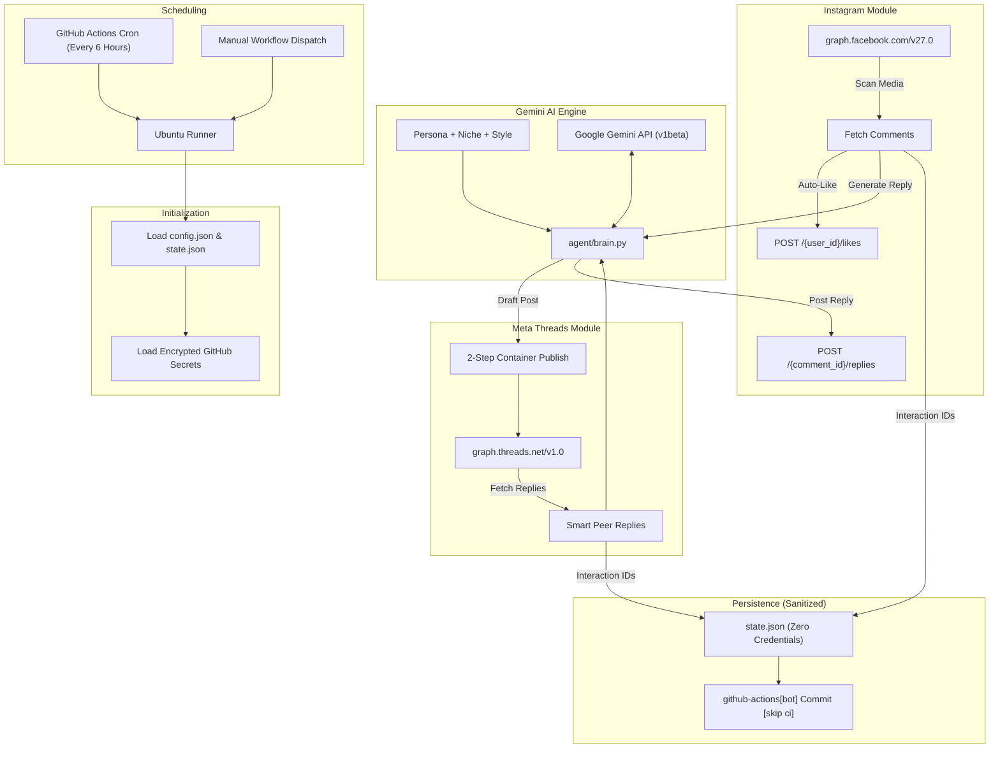

# 🤖 AI Social Media Agent (Meta Threads & Instagram)

[](LICENSE)
[](https://www.python.org/)
[](https://aistudio.google.com/)
[](https://github.com/features/actions)

A production-ready, open-source autonomous AI social media agent that crafts authentic, high-engagement content and handles community interaction across both **Meta Threads** and **Instagram**.

Runs **100% serverless and free** on GitHub Actions with automated smart spam-filtered replies, real-time Cloudflare Worker webhooks, and independent platform controls.

---

## 🔒 Security & Privacy Architecture

This project is engineered with a **strict zero-leakage privacy model**, making it **100% safe for public repositories and forks**:

1. **Zero Credentials in Git**:
   - Personal account IDs (`THREADS_USER_ID`, `IG_USER_ID`) and secret credentials (`THREADS_ACCESS_TOKEN`, `IG_ACCESS_TOKEN`, `META_APP_ID`, `META_APP_SECRET`, `GEMINI_API_KEY`) are **never hardcoded** in any tracked repository file.
   - All credentials reside exclusively in **encrypted GitHub Repository Secrets** (for CI/CD automation) or git-ignored `.env` files (for local development).

2. **Sanitized State Persistence**:
   - `state.json` only tracks public interaction IDs (`threads_replied_ids`, `ig_replied_ids`, `ig_liked_ids`, `last_post_id`) so the agent never replies to or likes the same comment twice.
   - The storage engine (`agent/storage.py`) strictly strips all active access tokens before persisting `state.json` to disk. Even when `github-actions[bot]` commits updated state back to GitHub, **zero private tokens or personal identifiers are committed**.

3. **Safe Cloudflare Worker Deployment**:
   - The real-time Cloudflare Worker configuration (`cloudflare/wrangler.toml`) contains only placeholders. Sensitive tokens are passed securely as Cloudflare Worker Secrets (`wrangler secret put`).

---

## ⚡ Core Capabilities

- **Multichannel Autonomous Operation**:
  - **Meta Threads**: Generates context-aware, human-like posts and engages in community replies via the official 2-step container Graph API.
  - **Real-Time Instagram AI (Cloudflare Workers)**: Catches Meta Webhooks in under 2 seconds, auto-likes comments, and uses Gemini AI to reply on ANY Reel or Post 24/7.
- **Independent Modular Architecture**: Either platform can be toggled on/off independently in `config.json` or skipped gracefully if secrets are missing.
- **Powered by Google Gemini**: Leverages next-gen Gemini models via the official `google-genai` SDK with automatic failover and zero-cost operation.
- **Spam & Crypto Filtering**: Automatically flags and ignores promotional bots, crypto solicitors, and follow-bait while replying to real community members.

---

## 🏗️ System Architecture



---

## 🚀 Quick Setup Guide (For Forking)

### 1. Fork & Enable Permissions
1. Click **Fork** at the top right of this repository.
2. In your forked repository, go to **Settings > Actions > General**.
3. Under **Workflow permissions**, select **Read and write permissions** and click **Save**.

### 2. Customize `config.json`
Edit `config.json` directly from your browser to personalize your niche, personality, and platform toggles:

```json
{
  "niche": "Competitive Gaming, Valorant, and Dark Psychological Anime",
  "persona": "A 20-year-old gamer and anime fan posting raw, casual thoughts from their phone. Witty, blunt, relatable, never sounds like a brand or AI.",
  "custom_instructions": "Use natural phrasing and occasional lowercase. Never use corporate buzzwords, emojis, or motivational quotes. Maximum 1 hashtag or none at all. Focus on sparking debates and giving honest mini-reviews.",
  "post_styles": [
    "MINI_REVIEW",
    "QUESTION_DEBATE",
    "HOT_TAKE"
  ],
  "threads": {
    "enabled": true,
    "auto_post": true,
    "auto_reply": true,
    "max_threads_to_scan": 3
  },
  "instagram": {
    "enabled": true,
    "auto_reply_comments": true,
    "auto_like_comments": true,
    "max_posts_to_scan": 5
  },
  "gemini_model": "gemini-3-flash-preview"
}
```

---

## 🔑 Obtaining API Keys & Credentials

### A. Google Gemini API Key (Free)
1. Visit [Google AI Studio](https://aistudio.google.com/).
2. Click **Get API key** and create a new key.
3. Save as secret: `GEMINI_API_KEY`.

---

### B. Meta Threads API Credentials
1. Go to [Meta for Developers](https://developers.facebook.com/) and create or open your App.
2. Add the **Threads** use case / product.
3. In **Threads > Roles**, add your personal Threads username as a **Threads Tester**.
4. Open Threads on your mobile device or web, go to **Settings > Account > Website permissions > Invites**, and click **Accept**.
5. Generate a **User Access Token** with permissions:
   - `threads_basic`
   - `threads_content_publish`
   - `threads_read_replies`
   - `threads_manage_replies`
6. Get your numeric User ID by making a quick request:
   ```bash
   curl -s -X GET "https://graph.threads.net/v1.0/me?access_token=YOUR_TOKEN"
   ```
7. Save as secrets:
   - `THREADS_ACCESS_TOKEN`
   - `THREADS_USER_ID`

---

### C. Instagram Graph API Credentials
1. Ensure your Instagram account is switched to a **Professional Account** (Creator or Business).
2. Connect your Instagram account to a **Facebook Page** (in Instagram Settings > Creator / Business > Connect a Page).
3. In [Meta for Developers](https://developers.facebook.com/), create an app with the **Business** type.
4. Add the **Instagram Graph API** product and generate a User Access Token with:
   - `instagram_basic`
   - `instagram_manage_comments`
   - `instagram_manage_engagement`
   - `pages_read_engagement`
5. Query your Instagram Business Account ID:
   ```bash
   curl -s -X GET "https://graph.facebook.com/v27.0/me/accounts?access_token=YOUR_TOKEN"
   ```
6. Save as secrets:
   - `IG_ACCESS_TOKEN`: The generated Instagram user access token.
   - `IG_USER_ID`: The numeric Instagram Business Account ID.
   - `META_APP_ID`: Your Meta App ID (under App Settings > Basic).
   - `META_APP_SECRET`: Your Meta App Secret (under App Settings > Basic).

---

## 🔒 GitHub Repository Secrets Configuration

In your GitHub repository, navigate to **Settings > Secrets and variables > Actions** and add the following:

| Secret Name | Required For | Description |
|---|---|---|
| `GEMINI_API_KEY` | **Core** | Google Gemini API Key |
| `THREADS_ACCESS_TOKEN` | Threads | Long-lived Threads access token |
| `THREADS_USER_ID` | Threads | Numeric Threads user ID |
| `IG_ACCESS_TOKEN` | Instagram | Instagram Graph API user access token |
| `IG_USER_ID` | Instagram | Instagram Business Account ID |
| `META_APP_ID` | Meta App | Meta App ID (for token validation) |
| `META_APP_SECRET` | Meta App | Meta App Secret (for token validation) |

> **Note**: If you only configure Threads secrets, the Instagram module skips gracefully without failing. If you only configure Instagram secrets, the Threads module skips gracefully.

---

## ⚡ (Optional) Real-Time Instagram AI via Cloudflare Worker

To enable instant (< 2 second) auto-replies to comments via Meta Webhooks:

1. Create a free account at [Cloudflare](https://dash.cloudflare.com/).
2. Navigate to `cloudflare/` and deploy:
   ```bash
   cd cloudflare
   npx wrangler deploy
   ```
3. Set your private secrets safely in Cloudflare (never in `wrangler.toml`):
   ```bash
   npx wrangler secret put IG_ACCESS_TOKEN
   npx wrangler secret put IG_USER_ID
   npx wrangler secret put GEMINI_API_KEY
   npx wrangler secret put WEBHOOK_VERIFY_TOKEN
   ```
4. In your Meta Developer App, go to **Webhooks > Instagram**, set the Callback URL to your Worker URL (`https://<worker-name>.<subdomain>.workers.dev`), and subscribe to the `comments` field.

---

## 🛠️ Local Development & Testing

```bash
# 1. Clone repository
git clone https://github.com/Lakshay-exec/social-media-agent.git
cd social-media-agent

# 2. Set up virtual environment
python -m venv venv
source venv/bin/activate  # On Windows: venv\Scripts\activate

# 3. Install dependencies
pip install -r requirements.txt

# 4. Copy environment template and fill in keys
cp .env.example .env

# 5. Run agent
python main.py
```

---

## 📄 License

Distributed under the **MIT License**. See [`LICENSE`](LICENSE) for details.

Developed with ❤️ by **[Lakshay](https://github.com/Lakshay-exec)**.
